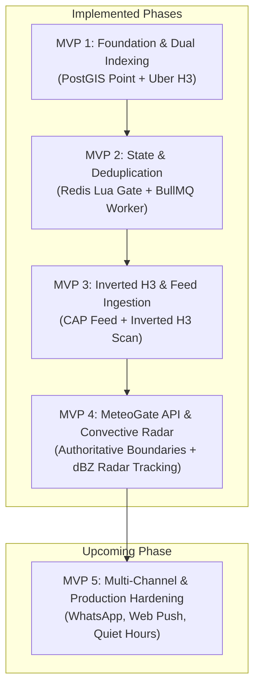

# Weather Alert App — MVP Documentation & Roadmap

This directory contains the specifications, architectural plans, and verification procedures for each MVP phase of the Severe Weather Alert System.

## Architecture Vision & Overview

The Severe Weather Alert System is a hyper-local, real-time alert engine designed for convective storms, severe hail, and hazardous meteorological events across Italy and Europe.

> [!NOTE]
> For a detailed, issue-by-issue breakdown of architectural trade-offs, evaluated alternatives, and technical decisions made from inception to present, refer to the **[Engineering Challenges & Decisions Log](CHALLENGES_AND_DECISIONS.md)**.



---

## MVP Index & Implementation Checklist

### ✅ Phase 1: Foundation & Dual Spatial Indexing ([MVP 1 Plan](mvp1-plan.md))
- [x] Bun runtime environment with native TypeScript execution and `.env` parsing
- [x] PostgreSQL 16 + PostGIS 3.4 infrastructure via Docker Compose (`5433`)
- [x] Drizzle ORM schema with custom `geography(Point, 4326)` mapping
- [x] Dual spatial representation: PostGIS spherical Point + Uber H3 cell index (`h3.latLngToCell`)
- [x] Telegram Bot onboarding via `grammY` (`/start`, `message:location`)
- [x] Baseline spherical spatial matching (`ST_Covers`)
- [x] Standalone spatial simulation CLI suite (`bun run simulate`)

### ✅ Phase 2: Distributed State & Deduplication ([MVP 2 Plan](mvp2-plan.md))
- [x] Redis 7 infrastructure via Docker Compose (`6380`)
- [x] Atomic Redis Lua deduplication script (`DEDUP_LUA_SCRIPT`)
  - [x] Initial alert dispatch (`Code 1`)
  - [x] Escalation bypass for rising severity (`Code 2`)
  - [x] Cooldown suppression window (`Code 0`)
  - [x] Expiration-aware TTL management
- [x] Failed dispatch reservation rollback (`releaseFailedAlertDispatch`)
- [x] BullMQ asynchronous message queue (`alert-dispatch`) with exponential backoff
- [x] Rate-limited Telegram worker (30 messages/sec)
- [x] Bull Board real-time monitoring UI dashboard (`/ui`)
- [x] Multi-sweep deduplication verification suite (`bun run test:dedup`)

### ✅ Phase 3: Inverted H3 Spatial Engine & Feed Ingestion ([MVP 3 Plan](mvp3-plan.md) | [Spatial Methodology](spatial-engine-methodology.md))
- [x] Inverted H3 spatial matching engine (`alertToH3Cells` + coarse-to-fine B-Tree index scan)
- [x] 1-ring hexagon buffer (`gridDisk`) ensuring zero boundary misses and 100% PostGIS parity (see [Methodology Guide](spatial-engine-methodology.md))
- [x] CAP alert normalization across 14 MeteoAlarm hazard types and awareness levels (Yellow, Orange, Red)
- [x] Multi-area polygon merging for split CAP warning features (`mergeMeteoAlarmWarningAreas`)
- [x] Universal Telegram API fallback transformer (gracefully handles HTML parse errors as plain text)
- [x] On-demand feed query command (`/pollalerts`) & H3 benchmark command (`/testh3match`)
- [x] Automated 10-minute authoritative warning poller with concurrency mutex

### ✅ Phase 4: MeteoGate API & Live Doppler Radar Nowcasting ([MVP 4 Plan](mvp4-plan.md) | [Radar Methodology](radar-nowcasting-methodology.md))
- [x] EUMETNET MeteoGate Warnings API integration (`api.meteogate.eu/warnings`)
- [x] Authoritative EMMA warning boundary ingestion and caching (`meteoalarm_zones`)
- [x] Live OPERA European radar composite ingestion (`.h5` HDF5 format via `jsfive`)
- [x] In-memory projection conversion from LAEA to WGS84 via `proj4`
- [x] Convective core clustering ($\ge 40\text{ dBZ}$) and connected-component analysis
- [x] Storm cell tracking across radar sweeps (displacement, velocity in km/h, compass heading)
- [x] Radar tracking state persistence in Redis (`radar:previous_scan`) across restarts
- [x] Hyper-local dynamic user ETA calculation (along-track / cross-track trajectory cone; see [Radar Methodology](radar-nowcasting-methodology.md))
- [x] PostGIS spatial bounding box optimization for radar user queries (`location && ST_MakeEnvelope`)
- [x] Radar tracking simulation suite (`bun run test:radar`)

### 🔮 Phase 5: Multi-Hazard Threshold Alerts & Production Hardening ([MVP 5 Plan](mvp5-plan.md) | [Threshold Methodology](threshold-alerts-methodology.md))
- [ ] Quantitative NWP forecast ingestion via Open-Meteo (ECMWF IFS / DWD ICON)
- [ ] User-configurable thresholds: Rainfall (mm), Snowfall (cm), Wind Gusts (km/h), Frost (°C), Heat (°C), and Hail Risk
- [ ] Consolidated multi-hazard card bundling (merges concurrent breaches into a single notification)
- [ ] Interactive Telegram menu (`/thresholds`) with inline presets and quick slash commands (`/setrain`, etc.)
- [ ] 24-hour Redis deduplication window to prevent alert fatigue
- [ ] User-configurable alerting thresholds (minimum severity level: Yellow vs Orange vs Red)
- [ ] Convective / Hail only filtering toggle (`/settings` or `/setlevel`)
- [ ] Multi-zone monitoring per user (e.g. Home, Office, Vacation home)
- [ ] Quiet hours with life-safety overrides (extreme Red alerts bypass quiet hours)
- [ ] Multi-channel delivery adapters:
  - [ ] Web Push (PWA) notifications
- [ ] Production webhook migration for Telegram bot (replacing long polling)
- [ ] Automated unit test suite with `bun test` for pure normalization, tracking, and formatting logic

---

## System Verification Commands

To verify the components built across MVPs 1–4:

```bash
# Inverted H3 matching & MeteoGate live ingestion
bun run poll

# Multi-sweep Redis Lua deduplication & escalation test
bun run test:dedup

# PostGIS & H3 spatial simulation
bun run simulate

# Doppler radar cell tracking & dynamic ETA simulation
bun run test:radar

# Start development server with background poller, Bull Board, and Telegram bot
bun run dev
```

Dashboard available at: **http://localhost:3000/ui**
