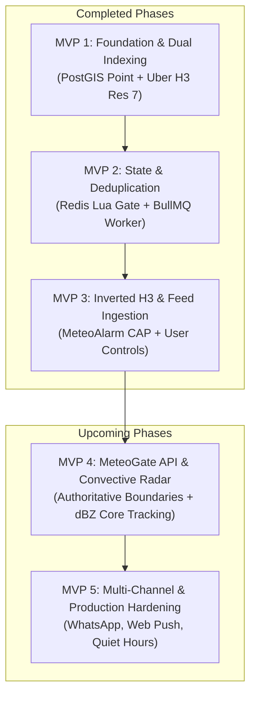

# Weather Alert App — MVP Documentation & Roadmap

This directory contains the specifications, architectural plans, and verification procedures for each MVP phase of the Severe Weather Alert System.

## Architecture Vision & Overview

The Severe Weather Alert System is a hyper-local, real-time alert engine designed for convective storms, severe hail, and hazardous meteorological events across Italy and Europe.



---

## MVP Index

| Document | Phase | Status | Key Deliverables |
| :--- | :--- | :---: | :--- |
| [MVP 1 Plan](file:///Users/alex/Code/alex/weather-alert/docs/mvp1-plan.md) | **Foundation & Dual Indexing** | ✅ Complete | Bun runtime, Docker PostGIS (`5433`), grammY bot, dual spatial representation (`Point` + H3 Res-7 `871ea5599ffffff`), PostGIS `ST_Covers` baseline. |
| [MVP 2 Plan](file:///Users/alex/Code/alex/weather-alert/docs/mvp2-plan.md) | **Distributed State & Deduplication** | ✅ Complete | Docker Redis 7 (`6380`), atomic Lua deduplicator (`45-min cooldown`, `1.5 cm escalation delta`), BullMQ async dispatch, Bull Board (`/ui`). |
| [MVP 3 Plan](file:///Users/alex/Code/alex/weather-alert/docs/mvp3-plan.md) | **Inverted H3 Matching & Live CAP** | ✅ Complete | MeteoAlarm Italy Atom feed ingestion, in-memory `h3.polygonToCells(coords, 7)`, sub-millisecond B-Tree spatial scan, strict geometry matching, 14 official hazard types + exact awareness colors. |
| [MVP 4 Plan](file:///Users/alex/Code/alex/weather-alert/docs/mvp4-plan.md) | **MeteoGate API & Live Convective Radar** | 🚀 Ready to Build | EUMETNET MeteoGate API (`api.meteogate.eu`), authoritative EMMA boundary polygons from Redistribution Hub, Doppler radar composite ($\ge 50\text{ dBZ}$ hail cores), cell motion vectors, dynamic user ETA. |
| [MVP 5 Plan](file:///Users/alex/Code/alex/weather-alert/docs/mvp5-plan.md) | **Multi-Channel & Production Hardening** | 🔮 Roadmap | WhatsApp Cloud API, Web Push, quiet hours with life-safety overrides, secure HTTPS webhooks, multi-zone monitoring. |

---

## System Verification Commands

To verify the components built across MVPs 1–3:

```bash
# Inverted H3 matching & MeteoAlarm live ingestion
bun run poll

# Multi-sweep Redis Lua deduplication & escalation test
bun run test:dedup

# PostGIS spatial simulation
bun run simulate

# Start development server with background poller, Bull Board, and Telegram bot
bun run dev
```

Dashboard available at: **http://localhost:3000/ui**
