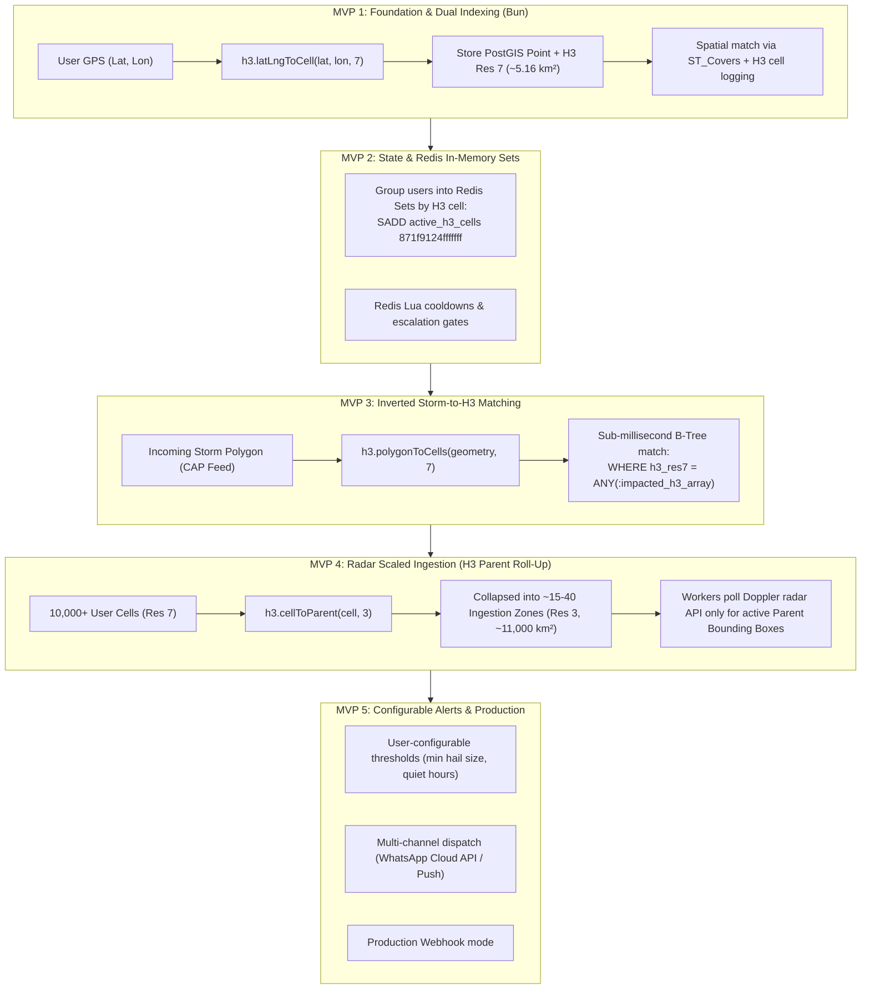

# Implementation Plan — Weather Alert App (MVP 1 with Bun & Uber H3)

## Goal: MVP 1 "Walking Skeleton" with Bun, Uber H3 & PostGIS Architecture

Build an automated, hyper-local severe weather alert system in TypeScript powered by **Bun**.

To ensure a smooth learning progression, the system is designed iteratively across MVPs. **Uber H3 (Hierarchical Hexagonal Spatial Index)** is the core spatial indexing strategy for the production architecture. 

In **MVP 1**, we establish the foundation:
1. **Dual Spatial Representation:** Each monitored location is stored both as a PostGIS spherical coordinate (`GEOGRAPHY(Point, 4326)`) and an **Uber H3 Resolution 7 hexagon** (`h3_res7`).
2. **Interactive Onboarding:** Users share their location via a Telegram bot (`grammY` with long polling); the bot indexes the location in both PostGIS and H3.
3. **Spatial Alert Evaluation:** A simulated hail storm cell is matched against registered locations using PostGIS `ST_Covers`, while logging H3 cell intersection metrics.
4. **Emergency Dispatch:** Affected users receive a formatted Telegram alert (MarkdownV2) with estimated hail size and safety recommendations.
5. **Bun Developer Experience:** Native TypeScript execution (`bun run`), built-in `.env` handling, and ultra-fast dependency management with `bun add`.

---

## The Uber H3 Multi-MVP Evolution

---

## Technology Stack for MVP 1

| Component | Technology | Rationale |
| :--- | :--- | :--- |
| **Runtime & Package Manager** | **Bun 1.2.11** | Native TypeScript support (no `tsx`/compilation), built-in `.env` loading, ultra-fast `bun add`. |
| **Database** | PostgreSQL 16 + PostGIS 3.4 (Docker) | Industry standard for spherical geospatial calculations. |
| **Database Access & Migrations** | Drizzle ORM (`drizzle-orm`, `drizzle-kit`, `postgres`) | Clean SQL migrations with native support for raw `sql` PostGIS queries. |
| **Geospatial Indexing** | Uber `h3-js` | Discrete global hexagonal grid for sub-millisecond storm cell matching. |
| **Bot Framework** | `grammY` | TypeScript-first Telegram bot framework using long-polling for local dev. |
| **Validation** | `zod` | Runtime schema validation for configuration and spatial payloads. |

---

## Proposed Changes & Scaffolding Steps

### Phase 1: Environment & Infrastructure
- [x] Initialize project with `bun init -y`.
- [x] Install dependencies with Bun:
  - `bun add drizzle-orm postgres h3-js grammy zod`
  - `bun add -d typescript @types/node drizzle-kit`
- [x] Create `docker-compose.yml` with `postgis/postgis:16-3.4` on port `5433` (to avoid conflicting with default port 5432).
- [x] Create `.env` and `.env.example` with database connection string and `TELEGRAM_BOT_TOKEN`.

### Phase 2: Database Schema & PostGIS Migrations
- [x] Create `src/db/schema.ts` defining `user_alert_zones` with PostGIS `location` and `h3_res7`.
- [x] Configure `drizzle.config.ts`.
- [x] Generate and apply migration with `bunx drizzle-kit generate` and migration runner.
- [x] Create database health check script (`src/db/check.ts`).

### Phase 3: Interactive Telegram Bot Setup
- [x] Create `src/bot/index.ts` initializing `grammY` bot instance.
- [x] Implement `/start` command prompting for location.
- [x] Implement `message:location` handler computing `h3.latLngToCell(lat, lon, 7)` and upserting into PostGIS.
- [x] Create MarkdownV2 message formatter (`src/bot/formatters.ts`).

### Phase 4: Spatial Matching Engine & Alert Simulator
- [x] Create `src/engine/matcher.ts` executing `ST_Covers` query with PostGIS.
- [x] Create `src/simulator/generate-alert.ts` to generate a synthetic hail polygon over registered coordinates.
- [x] Implement `/testalert` command in Telegram bot to trigger the full alert loop on demand.
- [x] Create standalone CLI script `bun run simulate` for headless testing.

---

## Verification Plan

### Automated Tests
1. **Database & PostGIS Check:** `bun run src/db/check.ts` (verifies PostGIS version and DB connection).
2. **H3 Spatial Conversion Test:** Unit test checking H3 Resolution 7 calculation and coordinate reversal.
3. **PostGIS Query Test:** Verify `ST_Covers` returns true for points inside the test polygon and false for outside points.

### Manual Verification
1. Spin up PostGIS: `docker compose up -d`.
2. Run database migration: `bun run migrate`.
3. Start the dev server: `bun run dev`.
4. Open Telegram bot, send `/start`, and share location.
5. Send `/testalert` in Telegram and receive severe hail warning notification.
