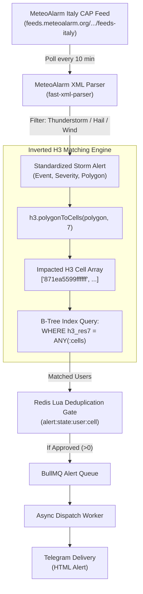

# Implementation Plan — Weather Alert App (MVP 3: MeteoAlarm Italy CAP Ingestion & Inverted H3 Matching)

## Goal: MVP 3 Live Weather Feeds for Italy & Inverted H3 Matching

In **MVP 1** and **MVP 2**, we established the spatial foundation, deduplication, and queuing using simulated storm cells. 

**MVP 3** connects the application to **real-world live weather alert feeds for Italy & Europe** using the official **MeteoAlarm Italy CAP Feed** and introduces **Inverted H3 Polygon Matching**:

1. **Official Italy & European CAP Ingestion:**
   * **Feed Endpoint:** `https://feeds.meteoalarm.org/feeds/meteoalarm-legacy-atom-italy`
   * **Source:** National Warning Feed issued by the Italian Meteorological Service (*Aeronautica Militare* / *Protezione Civile*) via EUMETNET MeteoAlarm.
   * **Standard:** Common Alerting Protocol (CAP v1.2 Atom/XML).
   * **Hazards Monitored:** Severe Thunderstorms & Convective Events, Large Hail, High Winds, Heavy Rain & Flash Flooding.
2. **XML Parsing with `fast-xml-parser`:**
   * Ultra-fast, zero-dependency XML parsing running natively on Bun.
   * Extracts emergency metadata: event name, severity level, description, safety instructions, and geographical polygons.
3. **Inverted H3 Spatial Matching Engine (`WHERE h3_res7 = ANY(...)`):**
   * Instead of evaluating every user point with heavy spherical polygon math (`ST_Covers`), invert the pipeline:
   * Convert incoming storm advisory polygons into arrays of H3 Resolution 7 cells using `h3.polygonToCells(geometry, 7)`.
   * Query matching users using a lightning-fast **B-Tree index scan** (`WHERE h3_res7 = ANY(:impacted_cells)`).
   * Benchmark and compare H3 B-Tree matching vs PostGIS `ST_Covers`.
4. **Automated Polling Worker & Manual Trigger:**
   * Background poller running on a scheduled interval (every 10 minutes, matching MeteoAlarm's update cadence).
   * Interactive `/pollalerts` command in Telegram to trigger a live feed check of Italy on demand.

---

## Architecture Flow for MVP 3



---

## User Review Required

> [!IMPORTANT]
> **Italy Data Source Confirmed:**
> The US NWS API only covers US territories. For Italy, we will use **MeteoAlarm Italy** (`feeds.meteoalarm.org`), which is the authoritative European public safety service specifically highlighted on pages 4–5 of the architecture specification.
> 
> * Free, public, zero API key required.
> * Fully authoritative official alerts for Italian regions (Veneto, Lombardia, Liguria, Toscana, etc.).

> [!NOTE]
> **Package to Install:**
> We will add `fast-xml-parser` via Bun (`bun add fast-xml-parser`) for parsing the CAP XML stream into TypeScript objects.

---

## Proposed Changes

### 1. Ingestion Layer (`src/ingestion`)

#### [NEW] `src/ingestion/types.ts`
* Interfaces for MeteoAlarm Atom entries, CAP 1.2 XML elements, and normalized `StormAlert` objects.

#### [NEW] `src/ingestion/providers/meteoalarm.ts`
* Fetches the live Italian feed from `https://feeds.meteoalarm.org/feeds/meteoalarm-legacy-atom-italy`.
* Parses Atom XML entries using `fast-xml-parser`.
* Follows CAP detail links to fetch full emergency warnings and polygons.
* Filters for convective phenomena (Thunderstorms, Hail, High Wind).

#### [NEW] `src/ingestion/normalizer.ts`
* Converts raw CAP XML alerts into standardized `StormAlert` objects:
  * Maps severity levels (`Moderate` $\rightarrow$ `WATCH`, `Severe` $\rightarrow$ `WARNING`, `Extreme` $\rightarrow$ `EMERGENCY`).
  * Normalizes CAP polygon strings (`lat,lon lat,lon ...`) into valid GeoJSON `[lon, lat]` coordinate arrays.
  * Extracts Italian or English instructions (`instruction` tag).

#### [NEW] `src/ingestion/poller.ts`
* Scheduled background worker running every 10 minutes.
* Pipeline: Fetch MeteoAlarm $\rightarrow$ Normalize $\rightarrow$ Match H3 $\rightarrow$ Redis Deduplicate $\rightarrow$ BullMQ Enqueue.

---

### 2. Inverted H3 Spatial Matching Engine (`src/engine`)

#### [NEW] `src/engine/h3-matcher.ts`
* Implements `matchStormUsingH3(alert: StormAlert): Promise<MatchedUser[]>`:
  ```typescript
  export async function matchStormUsingH3(alert: StormAlert): Promise<MatchedUser[]> {
    // 1. Convert storm polygon into H3 Resolution 7 cells in memory
    const impactedCells = h3.polygonToCells(alert.polygonGeoJson.coordinates, 7);

    if (impactedCells.length === 0) return [];

    // 2. High-speed B-Tree query against user_alert_zones
    return await db.execute(sql`
      SELECT 
        id,
        user_id AS "userId",
        telegram_chat_id AS "telegramChatId",
        location_name AS "locationName",
        h3_res7 AS "h3Res7",
        ST_X(location::geometry) AS lon,
        ST_Y(location::geometry) AS lat
      FROM user_alert_zones
      WHERE h3_res7 = ANY(${impactedCells});
    `);
  }
  ```

---

### 3. Telegram Bot & Dev Server Integration

#### [MODIFY] [src/bot/handlers.ts](file:///Users/alex/Code/alex/weather-alert/src/bot/handlers.ts)
* Add `/pollalerts` command:
  * Triggers an immediate poll of active MeteoAlarm warnings across Italy.
  * Replies with an Italian alert summary (e.g. *"📡 Polled MeteoAlarm Italy: 4 active warnings found (Liguria, Piemonte, etc.). 0 users currently in impact zones."*).
* Add `/testh3match` command:
  * Runs both PostGIS `ST_Covers` and Inverted H3 B-Tree matching on a test polygon and compares their execution speeds side-by-side.

#### [MODIFY] [src/index.ts](file:///Users/alex/Code/alex/weather-alert/src/index.ts)
* Start background MeteoAlarm poller service on a 10-minute recurring schedule.

---

### 4. Standalone CLI & Verification Suite

#### [NEW] `src/simulator/test-cap-ingestion.ts`
* Standalone script verifying:
  1. Live HTTP fetch from MeteoAlarm Italy (`HTTP 200`).
  2. Parsing of CAP XML into TypeScript objects.
  3. Conversion of Italian CAP polygons into H3 cells.
  4. Accuracy comparison between Inverted H3 match vs PostGIS `ST_Covers`.
* Add `"poll"` script to `package.json`: `bun run poll`.

---

## Verification Plan

### Automated Tests
1. **Live MeteoAlarm Connection Test:**
   * Script fetches live Italian feed and verifies valid Atom XML structure, parsing at least 1 real European weather entry.
2. **Inverted H3 vs PostGIS Benchmark:**
   * Compares execution time of `ST_Covers` vs `WHERE h3_res7 = ANY(...)`.
   * Asserts identical matching accuracy.

### Manual Verification
1. Run `bun run dev`.
2. In Telegram bot `@garota_do_tempo_bot`, send `/pollalerts`.
3. Verify live active alerts for Italy are fetched, parsed, and logged in the terminal and in Bull Board (`http://localhost:3000/ui`).
4. Send `/testh3match` to view the side-by-side benchmark comparing PostGIS vs Uber H3!
