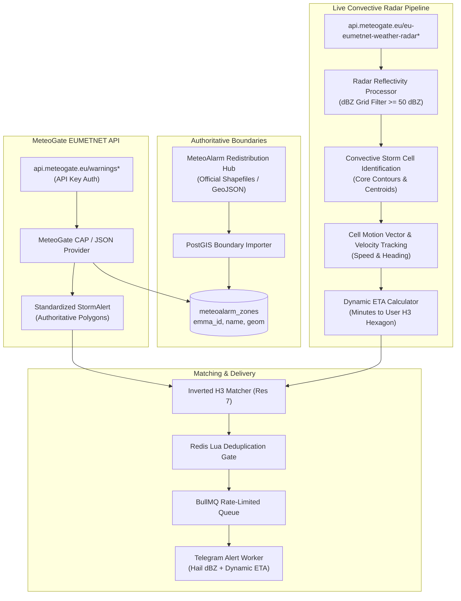

# Implementation Plan — Weather Alert App (MVP 4: MeteoGate API, Authoritative Boundaries & Live Radar)

## Goal: MVP 4 Real-Time Convective Radar & Authoritative Warning Boundaries

In MVPs 1–3, we established the core spatial indexing (PostGIS + Uber H3 Res-7), state management (Redis Lua deduplication gate), asynchronous queuing (BullMQ), and official CAP 1.2 alert feed ingestion.

**MVP 4** transforms the application from passive public feed aggregation to **authoritative, real-time convective storm and hail tracking**:
1. **Authoritative Warning Boundaries (MeteoAlarm Redistribution Hub):**
   - Ingest official EMMA warning zone Shapefiles / GeoJSON boundaries into PostGIS (`meteoalarm_zones` table).
   - Authoritatively resolve any warning referencing an `EMMA_ID` (e.g., `IT018`) to its official polygon, strictly eliminating any manual coordinate approximations.
2. **EUMETNET MeteoGate API Integration:**
   - Integrate with `https://api.meteogate.eu/warnings*` (Quota: 500 req/1h, Rate: 30 req/s) using the user's MeteoGate API key.
   - Modern RESTful JSON/CAP alert consumption alongside or replacing the legacy Atom XML feed.
3. **Live Doppler Weather Radar & Convective Hail Tracking:**
   - Consume European OPERA radar composites via `https://api.meteogate.eu/eu-eumetnet-weather-radar*` (Quota: 2000 req/1h, Rate: 200 req/s).
   - Isolate high-reflectivity convective cores ($\ge 50\text{ dBZ}$) associated with severe hail and supercells.
   - Compute storm cell motion vectors (speed and heading in knots / km/h).
4. **Hyper-Local Dynamic ETA Calculation:**
   - Calculate precise time-to-impact (ETA in minutes) from the moving hail core to the user's registered location (e.g., Mira, Veneto).
5. **H3 Spatial Parent Roll-Up (Scaled Radar Ingestion):**
   - Group thousands of Resolution 7 user hexagons into Resolution 3 parent zones (`h3.cellToParent(cell, 3)`) to minimize radar bounding-box polling overhead.

---

## Architecture Flow for MVP 4



---

## Detailed Components to Build

### 1. Database Migration: `meteoalarm_zones`
- Table schema in `src/db/schema.ts`:
  ```typescript
  export const meteoalarmZones = pgTable('meteoalarm_zones', {
    id: serial('id').primaryKey(),
    emmaId: varchar('emma_id', { length: 32 }).notNull().unique(), // e.g. 'IT018'
    countryCode: varchar('country_code', { length: 4 }).notNull(),  // e.g. 'IT'
    name: varchar('name', { length: 255 }).notNull(),               // e.g. 'Veneto'
    geometry: geometry('geometry', { type: 'MultiPolygon', srid: 4326 }).notNull(),
    createdAt: timestamp('created_at').defaultNow().notNull(),
  });
  ```
- Import CLI script: `src/scripts/import-meteoalarm-zones.ts` downloading/parsing official GeoJSON shapes into PostGIS with spatial indexing (`CREATE INDEX idx_meteoalarm_zones_geom ON meteoalarm_zones USING GIST (geometry)`).

### 2. MeteoGate API Client (`src/ingestion/providers/meteogate.ts`)
- Authenticated HTTP client communicating with `https://api.meteogate.eu`:
  - `METEOGATE_API_KEY` configuration in `.env` and `src/config/env.ts`.
  - Endpoint `GET /warnings` with rate-limiting guard (30 req/s, 500 req/h).
  - Matches warning `area.geocode` / `EMMA_ID` against `meteoalarm_zones` to attach 100% authoritative boundary polygons.

### 3. Convective Radar Ingestion & Hail Core Tracking (`src/radar`)
- Endpoint: `GET /eu-eumetnet-weather-radar` (OPERA European radar composite).
- Reflectivity thresholding:
  - $\ge 40\text{ dBZ}$: Heavy precipitation / convective storm.
  - $\ge 50\text{ dBZ}$: Severe storm / high probability of small hail ($1\text{--}2\text{ cm}$).
  - $\ge 60\text{ dBZ}$: Extreme supercell / large hail ($\ge 3\text{--}5\text{ cm}$).
- Spatial cell centroid tracking across successive radar sweeps ($t_0$ and $t_{-5\text{min}}$) to derive storm speed ($\text{km/h}$) and direction ($\text{bearing}^\circ$).
- Extrapolates cone of trajectory towards user coordinates (e.g. Mira, Venice).

### 4. ETA & Dynamic Warning Formatter
- Telegram notification payload enhanced with:
  - 🛰️ **Radar Core:** $56\text{ dBZ}$ (Severe Hail Core)
  - ⏱️ **Estimated Arrival:** $18\text{ minutes}$ (Moving NE at $45\text{ km/h}$)
  - 🛡️ **Actionable Protection:** Shelter vehicle and secure outdoor items before 16:45 CEST.

---

## Verification & Test Plan

1. **Authoritative Boundary Verification:**
   - Ingest Italian and European warning areas.
   - Query coordinates for `Mira (45.4396, 12.1225)` and assert it strictly intersects the official Veneto zone polygon without any manual bounding boxes.
2. **MeteoGate Ingestion Test:**
   - Script `src/simulator/test-meteogate.ts` querying `https://api.meteogate.eu/warnings` using the API key.
3. **Radar Motion & ETA Simulation:**
   - Simulate a $55\text{ dBZ}$ hail cell $15\text{ km}$ south-west of Mira moving at $50\text{ km/h}$.
   - Verify ETA calculates to $\sim 18\text{ minutes}$ and correctly enqueues a high-priority alert.
