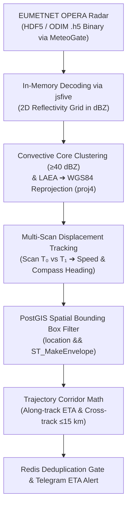

# 📡 Doppler Radar Nowcasting & Storm Tracking Methodology

This document details the engineering methodology behind the **Live Doppler Radar Ingestion, Convective Core Tracking, and Dynamic ETA Nowcasting Engine** implemented in [`src/radar/index.ts`](../src/radar/index.ts) and [`src/radar/tracking.ts`](../src/radar/tracking.ts).

---

## 1. Engineering Pipeline Overview



---

## 2. Ingestion & In-Memory Binary Decoding

Every 5 minutes, the engine queries the MeteoGate Radar API for the latest pan-European composite produced by **EUMETNET OPERA** (Operational Programme for the Exchange of Weather Radar Information).

### HDF5 / ODIM Data Container
The data arrives as an **ODIM (Operational Data Information Model)** HDF5 binary file (`.h5`):
* Decoded entirely in-memory using `jsfive` (zero temporary disk I/O).
* Extract attributes from `/what` (scan timestamp, gain, offset, nodata values) and `/where` (grid dimensions, scale, lower-left coordinate, projection definition).
* The raw reflectivity grid (`Float64Array`) is converted to physical **dBZ** (decibels of reflectivity):

$$\text{dBZ} = \text{rawValue} \times \text{gain} + \text{offset}$$

```text
                   Raw Radar Reflectivity Grid (dBZ)
                 [ 0 = Clear, 20 = Light Rain, 50+ = Hail ]

   Col:  10   11   12   13   14   15   16   17   18   19
  Row 10  .    .    .    .    .    .    .    .    .    .
  Row 11  .   15   20   22   18    .    .    .    .    .
  Row 12  .   25   35   42   38   20    .    .    .    .
  Row 13  .   30   48  [54]  44   25    .    .    .    .  <-- Convective Core
  Row 14  .   20   38   45   40   18    .    .    .    .      (Severe Hail Risk ≥40 dBZ)
  Row 15  .    .   15   20   15    .    .    .    .    .
```

---

## 3. Convective Core Clustering & Projection

Light precipitation covers vast areas and is not actionable for emergency alerts. The engine isolates severe convective cells using two steps:

### 1. Reflectivity Thresholding
* Pixels with $\text{dBZ} < 40$ are ignored.
* Pixels with $40 \le \text{dBZ} \le 85$ indicate strong convective updrafts, torrential rainfall, or damaging hail cores.

### 2. Connected-Component Clustering
Using a 2D flood-fill / queue algorithm, adjacent high-reflectivity pixels are grouped into coherent storm clusters:
* **Center of Mass:** Computes the weighted average row and column of the cluster.
* **Reprojection (`proj4`):** OPERA grids are encoded in **Lambert Azimuthal Equal Area (LAEA)** projection. The engine converts the centroid coordinates to standard WGS84 `(latitude, longitude)`.

```text
         Grid Clustering                           Centroid Calculation

           .  .  .  .  .                              .  .  .  .  .
         .   [42][38]   .                           .              .
        . [48][54][44]   .        ───►             .       +        .  (Centroid Lat/Lon)
         .   [45][40]   .                           .   Peak: 54 dBZ
           .  .  .  .  .                              .  .  .  .  .
```

---

## 4. Multi-Scan Motion Tracking (Speed & Bearing)

A single radar snapshot shows current position, but cannot indicate where a storm is moving. To solve this, the engine caches the previous scan's detected cells in Redis (`radar:previous_scan` with a 20-minute TTL).

When a new scan arrives:
1. **Time Delta Verification:** Calculates elapsed time $\Delta t = T_1 - T_0$. Scans must be between 2 and 20 minutes apart to be valid for velocity derivation.
2. **Nearest-Neighbor Centroid Matching:** Evaluates displacement between previous cells and current cells within a physically realistic ceiling:

$$\text{Max Distance (km)} = \text{MAX\_TRACK\_SPEED\_KMH} \times \Delta t_{\text{hours}} + 3\text{ km} \quad (\text{speed limit: } 100\text{ km/h})$$

```text
       Scan T₀ (14:00 UTC)                      Scan T₁ (14:05 UTC)
       
              Storm Cell #1                            Storm Cell #1
                   +                                         
             (45.2°N, 11.8°E)                                  +
                                                        (45.3°N, 12.1°E)
```

3. **Motion Vector Extraction:**
   * **Distance & Heading:** Computed via spherical forward azimuth and great-circle math.
   * **Speed:** $v = \Delta d / \Delta t$ ($\text{km/h}$).
   * **Compass Heading:** $\theta \in [0^\circ, 360^\circ)$ ($0^\circ = \text{North}, 90^\circ = \text{East}$).

---

## 5. PostGIS GiST Bounding-Box Optimization

Rather than performing vector trajectory projections against all registered users across the continent, PostGIS pre-filters candidate users inside a **120 km spatial envelope** using its **GiST spatial index**:

```sql
SELECT user_id, telegram_chat_id, location_name, h3_index,
       ST_Y(location::geometry) AS lat, ST_X(location::geometry) AS lon 
FROM user_alert_zones
WHERE location && ST_MakeEnvelope(:minLon, :minLat, :maxLon, :maxLat, 4326)::geography;
```

```text
      PostGIS ST_MakeEnvelope (120 km Buffer around Active Storms)

      +-------------------------------------------------------+
      |                                                       |
      |                 Storm Vector                          |
      |                      \                                |
      |                       +---> (Moving at 58 km/h)       |
      |                                                       |
      |    User X                                   User Y    |
      |      *                                        *       |
      |                                                       |
      +-------------------------------------------------------+
      
       ▲ PostGIS GiST query instantly pulls candidate users X and Y;
         unrelated users across Europe are discarded in <1 ms.
```

---

## 6. Trajectory Corridor & Dynamic ETA Calculation

For every candidate user within the bounding box, the engine projects the storm's velocity vector into a **15 km threat corridor** ([`calculateETA`](../src/radar/tracking.ts)):

```text
                           THE 15-KM THREAT CORRIDOR
                           
                                                Corridor Boundary (+15 km)
       - - - - - - - - - - - - - - - - - - - - - - - - - - - - - - - - - - 
                                                        User B
                                                           * (Cross-track: 6 km)
                                                    
      [Storm Cell] === Heading: 65° ===► ── ── ── ── ── ── ── ── ── ── ── 
                                                     
                                                               User C
       - - - - - - - - - - - - - - - - - - - - - - - - - - - - - - * - - - 
                                                Corridor Boundary (-15 km)
                                                
                 * User A                                 * User D
            (Behind storm,                           (Too far off path,
             Along-track ≤ 0)                         Cross-track: 28 km)
```

### Orthogonal Decomposition Math:
Given relative displacement in kilometers between storm centroid and user $(\Delta East, \Delta North)$ and compass heading $\theta$:

$$\text{Along-Track (km)} = \Delta East \cdot \sin(\theta) + \Delta North \cdot \cos(\theta)$$

$$\text{Cross-Track (km)} = |\Delta East \cdot \cos(\theta) - \Delta North \cdot \sin(\theta)|$$

### Threat Evaluation Conditions:
1. **Directional Guard:** $\text{Along-Track} > 0$  
   *(If $\le 0$, the storm has already passed or is traveling away from the user $\rightarrow$ User A ignored).*
2. **Lateral Corridor Guard:** $\text{Cross-Track} \le 15\text{ km}$  
   *(If $> 15\text{ km}$, the storm will pass safely to the side $\rightarrow$ User D ignored).*
3. **Arrival ETA:**
   $$\text{ETA (minutes)} = \text{round}\left(\frac{\text{Along-Track (km)}}{\text{Speed (km/h)}} \times 60\right)$$
4. **Time Window Guard:** $0 < \text{ETA} \le 60\text{ minutes}$.

---

## 7. Deduplication & Telegram Delivery

When a user is threatened ($\text{ETA} \le 60\text{ min}$):

1. **Redis Deduplication:** Evaluated against `evaluateAlertDeduplication(chatId, cellId, severityRank=1, ..., expiresAt)`.
   * The lock key expires at $\text{ETA} + 10\text{ minutes}$.
   * Prevents spamming the user on every subsequent 5-minute radar sweep while the same storm cell is en route.
2. **BullMQ Dispatch:** Dispatched with priority 3 to avoid blocking higher-priority emergency civil protection warnings.

```text
  📱 Telegram Alert Delivered to User B:
  ──────────────────────────────────────────
  ⛈️ LIVE DOPPLER RADAR NOWCAST: Venice
  
  ⚠️ High-Reflectivity Convective Core Approaching
  • Peak Reflectivity: 54 dBZ (Severe Hail Risk)
  • Estimated Arrival: ~25 minutes
  • Storm Velocity:    58 km/h
  • Compass Heading:   65° (ENE)
  ──────────────────────────────────────────
```
