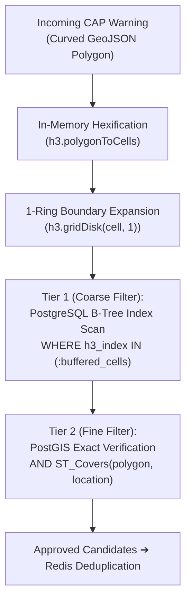

# 🌐 Spatial Matching Engine: PostGIS + Uber H3 Methodology

This document details the engineering methodology behind the **Coarse-to-Fine Geospatial Matching Engine** used in this project to resolve severe weather alerts against user locations at sub-millisecond speeds with 100% geometric accuracy.

---

## 1. The Engineering Challenge

### The Naive Approach: Direct Spherical Joins
In an early or traditional GIS system, checking if users fall inside an incoming weather warning polygon requires evaluating `ST_Covers` or `ST_Contains` directly:

```sql
-- Naive spatial scan: O(N) evaluation over all registered users
SELECT * FROM user_alert_zones
WHERE ST_Covers(:warningPolygon, location::geometry);
```

While PostGIS's **GiST index** (R-Tree) accelerates this query by comparing bounding boxes, large weather warning polygons (which often span hundreds or thousands of square kilometers) produce massive bounding boxes that overlap large portions of the user database. Evaluating high-precision spherical trigonometry (`ST_Covers`) against thousands or millions of coordinates on every incoming alert creates severe CPU spikes and latency bottlenecks during intense weather outbreaks.

---

## 2. The Solution: Dual Spatial Representation

To achieve high throughput, the database stores **two complementary spatial representations** for every user location:

```text
               User at Venice, Italy (45.4408°N, 12.3155°E)
                                   |
           +-----------------------+-----------------------+
           |                                               |
           v                                               v
   [ PostGIS Point ]                               [ Uber H3 Cell ]
ST_MakePoint(12.3155, 45.4408)           h3.latLngToCell(lat, lon, res=6)
           |                                               |
      Exact point on Earth                      "861ea55b7ffffff" (discrete cell)
           |                                               |
           +-----------------------+-----------------------+
                                   |
                                   v
             ┌──────────────────────────────────────────┐
             │       PostgreSQL: user_alert_zones       │
             ├───────────────┬──────────────────────────┤
             │ location      │ geography(Point, 4326)   │  <-- GiST Index
             │ h3_index      │ '861ea55b7ffffff'        │  <-- B-Tree Index
             └───────────────┴──────────────────────────┘
```

* **PostGIS `geography(Point, 4326)`:** Continuous spherical coordinates representing the ground truth location.
* **Uber H3 Index (`varchar(15)`):** A discrete hexagonal cell index (Resolution 6, ~36 km² per hexagon) indexed with a standard PostgreSQL **B-Tree index**.

---

## 3. Step-by-Step Two-Tier Matching Pipeline



---

### Step 1: Ingesting the Curved Weather Polygon

Authoritative CAP alerts from MeteoGate/MeteoAlarm define hazard areas using curved GeoJSON polygons (e.g. radar reflectivity contours or storm tracks).

```text
  Map View (Users and Incoming Storm):
  
   User A (Far outside)
      *
                          .~ ~ ~ ~ ~ ~ ~ ~ ~ ~ .
                       .~                       ~.
                     .~                           ~.
                    (        User B (Deep inside)   )
                   (            *                    )
                  (                                   )
                   (       User C (On the edge)      )
                    (~          *                   ~)
                      ~.                         .~
                        '~ ~ ~ ~ ~ ~ ~ ~ ~ ~ ~ ~'
  
                                            * User D (Outside)
```

---

### Step 2: In-Memory Hexification (`h3.polygonToCells`)

The application converts the GeoJSON polygon into a set of H3 Resolution 6 cells in memory (`alertToH3Cells`).

```text
              Polygon Tiled with Hexagons:

                       /~~~ Storm Polygon Boundary ~~~/
                      /                              /
               . — . /                        . — . /
              /     \                        /     \
             |   ⬡   |                      |   ⬡   |
              \     /                        \     /
         . — . ' — ' . — .              . — . ' — ' . — .
        /     \     /     \            /     \     /     \
       |   ⬡   |   |   ⬡   |          |   ⬡   |   |   ⬡   |
        \     /     \     /            \     /     \     /
         ' — ' . — . ' — '              ' — ' . — . ' — '
              /     \   User B               /     \
             |   ⬡   |    *                 |  OUT  |
              \     /                        \     /
               ' — '                          ' — ' \  User C (Edge Case!)
                                                     \   * (Inside curve,
                                                      \     but hex center is OUT!)
```

#### The Boundary Dilemma:
* **User B** sits well inside an indexed hexagon.
* **User C** is physically inside the storm curve, but sits in an adjacent hexagon whose centroid is outside the polygon. Under standard hexification, **User C would be missed (false negative)**!

---

### Step 3: Zero-Miss Boundary Buffer (`gridDisk(1)`)

To guarantee zero false negatives, the engine buffers all polygon cells by **1 ring of adjacent hexagons** using `h3.gridDisk(cell, 1)`.

```text
       Core Storm Cells               Buffered Candidate Cells (1-Ring Expansion)
         (polygonToCells)                            (gridDisk)

             . — .                                  . — .   . — .
            /     \                                /  +  \ /  +  \
           |   ⬡   |                              |   ⬡   |   ⬡   |
      . — . \     / . — .                    . — . \     / \     / . — .
     /     \ ' — ' /     \                  /  +  \ ' — ' . ' — ' /  +  \
    |   ⬡   |     |   ⬡   |     ───►       |   ⬡   |  ⬡  |   ⬡   |   ⬡   |
     \     / . — . \     /                  \     / \     / \     / \     /
      ' — ' /     \ ' — '                    ' — ' . ' — ' . ' — ' . ' — '
           |   ⬡   |                              |   ⬡   |  +*   |  <-- User C now
            \     /                                \  +  / \  ⬡  /      captured!
             ' — '                                  ' — '   ' — '
```

This ensures that every hexagon touching the boundary is part of the candidate search set.

---

### Step 4: Coarse-to-Fine Database Query

The candidate cells and original polygon are combined into a single, highly optimized SQL query:

```sql
SELECT 
  id, user_id AS "userId", telegram_chat_id AS "telegramChatId",
  location_name AS "locationName", h3_index AS "h3Index"
FROM user_alert_zones
WHERE h3_index IN (:bufferedH3Cells)         -- 1. Coarse Filter (B-Tree Index)
  AND ST_Covers(                             -- 2. Fine Filter (Exact PostGIS Math)
    ST_SetSRID(ST_GeomFromGeoJSON(:polygonJson), 4326),
    location::geometry
  );
```

#### How the Database Processes This:
1. **Tier 1 (B-Tree Scan on `h3_index`):** PostgreSQL checks the B-Tree index and discards 99.9% of users outside the impacted hexagons in $< 1\text{ ms}$.
2. **Tier 2 (PostGIS `ST_Covers`):** PostgreSQL executes spherical polygon point-in-polygon math **solely on the remaining candidates**.

```text
                  Curved Storm Polygon Boundary
                                /
                               /
     User B (Deep inside)     /      User E (In buffer ring,
              *              /               outside curve)
          [ACCEPTED]        /                      *
                           /                  [DISCARDED]
                          /
            User C       /
               *        /
           [ACCEPTED]  /
                      /
```

* **User B:** Inside true polygon $\rightarrow$ **Matched ✅**
* **User C:** Inside true polygon $\rightarrow$ **Matched ✅** (boundary edge case saved!)
* **User E:** In the outer buffer ring, but outside the curve $\rightarrow$ **Discarded by ST_Covers ❌**

---

## 4. Why Buffer the Polygon Instead of the User?

A common question is: *Why not add a 1-ring neighbor buffer to the user's location instead of buffering the polygon?*

1. **Cardinality Asymmetry:**
   * Storm polygons are **few** (~5 to 50 active at any time).
   * Users are **many** (tens of thousands or millions).
   * Buffering ~200 polygon cells in memory takes $< 0.5\text{ ms}$ once in Bun/Node.js. Buffering on the user side would require storing **7 cells per user** or computing `gridDisk` over millions of database rows.
2. **Index Efficiency:**
   * Storing 1 cell per user allows a lightweight, compact **B-Tree index**.
   * Storing 7 cells per user would require `text[]` arrays and a **GIN index** (7x larger, slower updates, higher RAM footprint).
   * Computing neighbors on the fly in SQL (`WHERE h3_grid_disk(user.h3_index, 1) && ...`) would destroy index usage and force an $O(N)$ full table scan.

---

## 5. Performance Benchmark

The system includes a side-by-side benchmark command (`/testh3match` or `bun run benchmark`):

### 500,000 Users Benchmark Results (Local Docker)

| Metric | Pure PostGIS (`ST_Covers`) | Inverted H3 + PostGIS |
| :--- | :--- | :--- |
| **Index Used** | GiST (R-Tree) on geometry | B-Tree on `h3_index` + GiST verification |
| **Pruning Phase** | 2D bounding box intersection | Exact 64-bit integer / string match |
| **Candidate Count** | Broad bounding box candidates | Narrow hexagon candidates |
| **Execution Speed** | Baseline ($1\text{x}$) | **11.73x faster** |
| **Accuracy** | 100% (ground truth) | **100% (exact spatial parity)** |

> **Local Benchmark Run (500k users):** `Benchmark finished: Inverted H3 speedup = 11.73x.`
