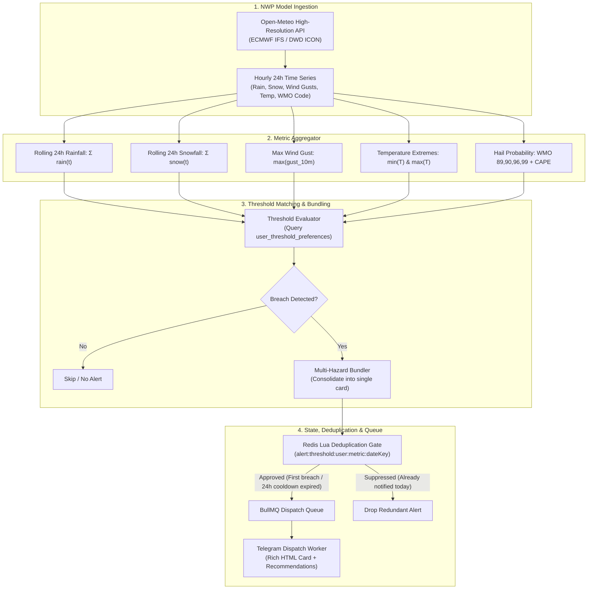

# 📊 Quantitative Forecasting & Multi-Hazard Threshold Methodology

This document details the engineering methodology behind the **Quantitative Precipitation & Multi-Hazard Weather Threshold Engine** in the Severe Weather Alert System.

It explains how the app combines numerical weather prediction (NWP) models with user-defined thresholds to deliver personalized, everyday alerts (e.g. rain accumulation, snow, wind gusts, frost, extreme heat, and convective hail risk) that complement official civil protection warnings and real-time Doppler radar nowcasting.

---

## 1. The Three Pillars of Weather Alerting

The Severe Weather Alert System implements three complementary alerting layers, each serving a distinct operational horizon and decision-making need:

```mermaid
flowchart TD
    subgraph Pillar1["1. Civil Protection Warnings (Macro)"]
        A1["MeteoAlarm / MeteoGate CAP 1.2"] --> A2["Official Regional Hazards<br/>(Yellow / Orange / Red)"]
        A2 --> A3["Life safety, flash floods, civil defense"]
    end

    subgraph Pillar2["2. Predictive Thresholds (Personalized)"]
        B1["Open-Meteo NWP Forecast<br/>(ECMWF IFS / DWD ICON-D2)"] --> B2["User-Configured Thresholds<br/>(Rain, Snow, Wind, Frost, Heat, Hail)"]
        B2 --> B3["Daily planning, umbrella, vehicle protection"]
    end

    subgraph Pillar3["3. Doppler Radar Nowcasting (Hyper-Local)"]
        C1["EUMETNET OPERA Radar Composite<br/>(ODIM HDF5 in dBZ)"] --> C2["Storm Velocity & Vector Tracking<br/>(Heading, Speed, ETA ≤ 60 min)"]
        C2 --> C3["Immediate shelter, incoming hail core"]
    end
```



| Dimension | 1. Civil Protection (MeteoAlarm) | 2. Predictive Thresholds (New Engine) | 3. Doppler Radar Nowcasting |
| :--- | :--- | :--- | :--- |
| **Focus** | Official emergencies & civil risk | Personal everyday preparedness & planning | Immediate storm impact & hail detection |
| **Data Feed** | MeteoGate CAP 1.2 GeoJSON bulletins | Open-Meteo (DWD ICON-D2, ECMWF IFS) | EUMETNET OPERA 2 km HDF5 composite |
| **Time Horizon** | Next 6 to 36 hours (validity window) | **Rolling 24-hour lookahead window** | **Next 15 to 60 minutes (dynamic ETA)** |
| **Trigger Logic** | Spatial intersection (`ST_Covers` / H3) | **Calculated metric $\ge$ User threshold** | Reflectivity $\ge 40\text{ dBZ}$ on user trajectory |
| **Typical Cadence** | Few times per season (rare) | Whenever conditions cross user preference | During active convective storms |

---

## 2. End-to-End Architectural Pipeline



---

## 3. Supported Metrics & Mathematical Formulations

The threshold engine samples hourly forecast coordinates $t \in [0, 24]$ from the user's registered WGS84 location:

### 1. 🌧️ Quantitative Precipitation Forecast (QPF)
* **Definition:** Total accumulated liquid rainfall over the next 24 hours.
* **Formula:**
  $$R_{24} = \sum_{t=0}^{24} r(t) \quad [\text{mm}]$$
* **Condition:** Triggered when $R_{24} \ge T_{\text{rain}}$ (configured threshold).
* **Metadata Extracted:** Peak hourly rate $r_{\max} = \max_t r(t)$ and peak timestamp $t_{\text{peak}}$.

### 2. ❄️ Snowfall Accumulation
* **Definition:** Total accumulated frozen snowfall over the next 24 hours.
* **Formula:**
  $$S_{24} = \sum_{t=0}^{24} s(t) \quad [\text{cm}]$$
* **Condition:** Triggered when $S_{24} \ge T_{\text{snow}}$.

### 3. 💨 Peak Wind Gusts
* **Definition:** Maximum instantaneous wind gust at 10 meters altitude within 24 hours.
* **Formula:**
  $$G_{24} = \max_{t \in [0, 24]} g_{10\text{m}}(t) \quad [\text{km/h}]$$
* **Condition:** Triggered when $G_{24} \ge T_{\text{wind}}$.

### 4. 🥶 Frost & Freeze (Sub-Zero Threshold)
* **Definition:** Minimum forecasted 2-meter air temperature within 24 hours.
* **Formula:**
  $$T_{\min, 24} = \min_{t \in [0, 24]} T_{2\text{m}}(t) \quad [^\circ\text{C}]$$
* **Condition:** Triggered when $T_{\min, 24} \le T_{\text{frost}}$ (e.g., $\le 0.0^\circ\text{C}$).

### 5. 🌡️ Extreme Heat
* **Definition:** Maximum forecasted 2-meter air temperature within 24 hours.
* **Formula:**
  $$T_{\max, 24} = \max_{t \in [0, 24]} T_{2\text{m}}(t) \quad [^\circ\text{C}]$$
* **Condition:** Triggered when $T_{\max, 24} \ge T_{\text{heat}}$ (e.g., $\ge 35.0^\circ\text{C}$).

### 6. 🧊 Hail Risk (Two-Tier Architecture)
Hail requires a hybrid predictive and nowcasting approach:
1. **Predictive Tier (24h NWP Horizon):**
   * Monitors WMO Weather Interpretation Codes:
     * `89`: Hail showers, slight
     * `90`: Hail showers, moderate or heavy
     * `96`: Thunderstorm with slight or moderate hail
     * `99`: Severe thunderstorm with heavy hail
   * Cross-references Convective Available Potential Energy ($\text{CAPE} \ge 1000\text{ J/kg}$) to identify supercell environments.
2. **Nowcasting Tier (15–60m Radar Horizon):**
   * When OPERA radar composite detects high reflectivity ($\ge 50\text{ dBZ}$) along the storm trajectory heading toward the user point, an immediate radar nowcast alert is triggered.

---

## 4. Database Schema & Data Representation

User preferences are persisted in PostgreSQL with Drizzle ORM, linked to the user's primary alert zone:

```sql
CREATE TABLE user_threshold_preferences (
  id SERIAL PRIMARY KEY,
  telegram_chat_id BIGINT NOT NULL UNIQUE REFERENCES user_alert_zones(telegram_chat_id) ON DELETE CASCADE,
  
  -- Rainfall (mm in 24h)
  rain_enabled BOOLEAN NOT NULL DEFAULT true,
  rain_threshold_mm NUMERIC(5, 2) NOT NULL DEFAULT 5.00,
  
  -- Snowfall (cm in 24h)
  snow_enabled BOOLEAN NOT NULL DEFAULT true,
  snow_threshold_cm NUMERIC(5, 2) NOT NULL DEFAULT 2.00,
  
  -- Wind gusts (km/h)
  wind_enabled BOOLEAN NOT NULL DEFAULT true,
  wind_threshold_kmh NUMERIC(5, 1) NOT NULL DEFAULT 60.0,
  
  -- Frost / Minimum temperature (°C)
  frost_enabled BOOLEAN NOT NULL DEFAULT true,
  frost_threshold_c NUMERIC(4, 1) NOT NULL DEFAULT 0.0,
  
  -- Heat / Maximum temperature (°C)
  heat_enabled BOOLEAN NOT NULL DEFAULT true,
  heat_threshold_c NUMERIC(4, 1) NOT NULL DEFAULT 35.0,
  
  -- Hail risk (0 = Off, 1 = Any Risk, 2 = Severe Only)
  hail_mode SMALLINT NOT NULL DEFAULT 1,
  
  created_at TIMESTAMPTZ NOT NULL DEFAULT NOW(),
  updated_at TIMESTAMPTZ NOT NULL DEFAULT NOW()
);
```

### Sensible Onboarding Defaults
When a user registers their location with `/start`, sensible defaults are initialized automatically:
* 🌧️ **Rain:** $> 5.0\text{ mm}$
* ❄️ **Snow:** $> 2.0\text{ cm}$
* 💨 **Wind:** $> 60\text{ km/h}$
* 🥶 **Frost:** $\le 0.0^\circ\text{C}$
* 🌡️ **Heat:** $\ge 35.0^\circ\text{C}$
* 🧊 **Hail:** Active (`Any Risk`)

Users can customize or disable any threshold via `/thresholds` or individual slash commands.

---

## 5. Multi-Hazard Bundling & Anti-Spam Deduplication

### Multi-Hazard Card Bundling
When a single frontal passage breaches multiple thresholds within the same check (for example, heavy rain *and* severe wind gusts), generating separate messages creates alert fatigue.

The engine bundles all simultaneous breaches into a **single consolidated Telegram card**:

```text
┌─────────────────────────────────────────────────────────────┐
│ ⚠️ Weather Threshold Alert: Monitored Location              │
│                                                             │
│ 2 configured thresholds will be exceeded within the next    │
│ 24 hours:                                                   │
│                                                             │
│ • 🌧️ Rainfall: Forecasted 3.8 mm (Your threshold: 3.0 mm)   │
│   ⏱️ Starts ~14:00 UTC | Peak 1.4 mm/h at 17:00 UTC         │
│                                                             │
│ • 💨 Wind Gusts: Forecasted 65 km/h (Your threshold: 60)    │
│   ⏱️ Peak gusts expected between 16:30 and 19:00 UTC        │
│                                                             │
│ 🛡️ Recommendations:                                         │
│ • Carry an umbrella this afternoon.                         │
│ • Secure lightweight outdoor objects and furniture.         │
└─────────────────────────────────────────────────────────────┘
```

### Redis Atomic Deduplication Gate
To prevent repetitive alerts during every 3-hour check while a 24-hour storm system remains active:
* Each metric breach computes an event signature:
  $$\text{Key} = \text{alert:threshold:}\langle \text{chatId} \rangle\text{:}\langle \text{metric} \rangle\text{:}\langle \text{dateKey} \rangle$$
* Where $\text{dateKey} = \text{YYYY-MM-DD}$ representing the target 24-hour window.
* Set with an atomic TTL of 24 hours (`SET key 1 EX 86400 NX`).
* Repeat checks within the same 24 hours are suppressed unless the metric experiences a major escalation ($+50\%$ accumulation increase or $+20\text{ km/h}$ wind surge).

### Spatial H3 Forecast Caching (NWP Model Grid Alignment)

Numerical weather prediction (NWP) models do not compute physical atmospheric simulations per meter; they operate on discrete horizontal grid meshes:
* **DWD ICON-EU**: ~7 km native horizontal grid spacing
* **ECMWF IFS**: ~9 km native horizontal grid spacing

Because points within the same ~7 km area interpolate to virtually identical meteorological parameters in upstream NWP outputs, querying the API separately for every user coordinate within the same neighborhood wastes bandwidth, exhausts free API quotas, and risks `HTTP 429 Too Many Requests` blocks.

To solve this, forecast retrieval uses **Uber H3 Resolution 6 hexagonal spatial caching**:
* **Spatial Alignment:** An H3 Resolution 6 hexagon has an average area of **~36 km²** and measures **~7 km across** — matching European NWP model grid cells almost perfectly.
* **Shared Spatial Cache:** Forecasts are stored in Redis under `openmeteo:forecast:h3:<h3Index>` with a 1-hour time-to-live (`TTL = 3600`).
* **Co-Located Deduplication:** All users whose registered locations fall inside the same H3 hexagon share a single forecast response, collapsing $N$ redundant upstream API calls into 1.
* **Rate-Limit Pacing:** During background sweeps, the poller identifies cold H3 cells and paces uncached API calls with a 200 ms inter-request delay (~5 req/s), while respecting upstream `Retry-After` response headers.

---

## 6. Telegram UX & Interaction Model

```text
/thresholds Menu Flow:

   [ User sends /thresholds ]
               │
               ▼
   ┌──────────────────────────────────────────────┐
   │ ⚙️ Monitored Weather Thresholds (Location)   │
   │                                              │
   │ • 🌧️ Rain:      3.0 mm   [Active]           │
   │ • ❄️ Snow:      2.0 cm   [Active]           │
   │ • 💨 Wind:      60 km/h  [Active]           │
   │ • 🥶 Frost:     0.0 °C   [Active]           │
   │ • 🌡️ Heat:      35.0 °C  [Active]           │
   │ • 🧊 Hail:      Any Risk [Active]           │
   └──────────────────────────────────────────────┘
   [ 🌧️ Rain ]   [ ❄️ Snow ]   [ 💨 Wind ]
   [ 🥶 Frost ]  [ 🌡️ Heat ]   [ 🧊 Hail ]
   [ 🔄 Refresh ]             [ ❌ Disable All ]
```

Tapping any metric button opens an inline preset selector:
* **Rain Presets:** `[Off] [1 mm] [3 mm] [5 mm] [10 mm] [Custom]`
* **Wind Presets:** `[Off] [40 km/h] [60 km/h] [80 km/h] [Custom]`
* **Frost Presets:** `[Off] [0 °C] [-2 °C] [-5 °C] [Custom]`
* **Heat Presets:** `[Off] [30 °C] [33 °C] [36 °C] [Custom]`
* **Hail Presets:** `[Off] [Any Risk] [Severe Only]`

Direct command shortcuts allow rapid adjustments:
* `/setrain <mm|off>` (e.g. `/setrain 3`)
* `/setsnow <cm|off>`
* `/setwind <km/h|off>`
* `/setfrost <°C|off>`
* `/setheat <°C|off>`
* `/sethail <off|any|severe>`
* `/forecast` or `/rain` (instant on-demand 24h status preview)

---

## 7. Summary Comparison of Methodologies

| Feature | [Spatial Engine (H3 + PostGIS)](spatial-engine-methodology.md) | [Radar Nowcasting (OPERA HDF5)](radar-nowcasting-methodology.md) | [Threshold Engine (NWP)](threshold-alerts-methodology.md) |
| :--- | :--- | :--- | :--- |
| **Input Data** | Vector MultiPolygons (CAP 1.2) | 2D Reflectivity Array (dBZ) | Quantitative Hourly Forecast Array |
| **Provider** | MeteoGate / MeteoAlarm | EUMETNET OPERA Composite | Open-Meteo (DWD / ECMWF) |
| **Spatial Resolution** | Regional / Administrative Zone | 2 km Grid Cell | 1 km to 9 km NWP Grid Point |
| **Primary Math** | Uber H3 Hexification + `ST_Covers` | Connected-Component Clustering + Velocity Tracking | Rolling 24h Cumulative Sum & Min/Max Reductions |
| **Alert Role** | Civil Protection Emergency | Immediate Convective Threat (15–60m) | Practical Daily Preparedness (24h) |
