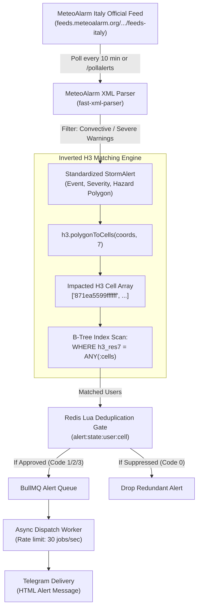

# Walkthrough — Weather Alert App (MVP 1, MVP 2 & MVP 3)

## Overview & Results

We have successfully implemented and verified **MVP 3** of the Severe Weather Alert System alongside **MVP 1** and **MVP 2** using **Bun**, **Docker PostGIS**, **Docker Redis 7**, **Uber H3**, **fast-xml-parser**, **BullMQ**, and **grammY**.

The system now integrates live weather intelligence for Italy and Europe:
1. **Official Italy & European CAP Ingestion (MVP 3):** Live connection to the official **MeteoAlarm Italy** Atom & CAP 1.2 feed (`feeds.meteoalarm.org/feeds/meteoalarm-legacy-atom-italy`), parsing multi-language hazard advisories, polygons, and regional boundaries.
2. **Inverted H3 Spatial Matching Engine (MVP 3):** Replaced spherical polygon intersection math (`ST_Covers`) with high-speed in-memory hexification (`h3.polygonToCells(coords, 7)`) and a B-Tree index scan (`WHERE h3_res7 = ANY(...)`).
3. **Automated Polling & Deduplication (MVP 3):** Background poller running on a 10-minute cadence matching MeteoAlarm's publication frequency, routing through the Redis Lua Deduplication Gate to prevent notification fatigue.
4. **User-Configurable Alert Level & Convective Filtering:** Each user can now select their desired minimum alarm threshold (`YELLOW` Gialla, `ORANGE` Arancione, or `RED` Rossa) and toggle between Convective/Hail only (Option A) vs All Weather via interactive `/settings` buttons or `/setlevel`.
5. **Exact Official Color Code Alerting (No Rephrasing):** Alert headers use the exact official warning color (`🟡 ALLERTA GIALLA`, `🟠 ALLERTA ARANCIONE`, `🔴 ALLERTA ROSSA`) without artificial "Severe Weather Alert" prefixes for mild/moderate advisories.
6. **Robust Date Window Formatting:** European/Italian `DD/MM/YYYY HH:mm` date formatting without inverted locale confusion (`MM/DD`). Expired warnings from past days are automatically dropped at ingestion.
7. **Interactive Telegram Inspection (MVP 3):** Added `/pollalerts`, `/settings`, `/setlevel`, `/status`, and `/testh3match`.

---

## Architecture Flow



---

## What Was Built for MVP 3

### 1. Dependencies & XML Parser
* Installed `fast-xml-parser` (`bun add fast-xml-parser`) for high-throughput, native XML parsing without native C++ compilation bindings.

### 2. Ingestion Layer (`src/ingestion`)
* [types.ts](file:///Users/alex/Code/alex/weather-alert/src/ingestion/types.ts): TypeScript interfaces for MeteoAlarm Atom entries, CAP 1.2 XML nodes, geocodes, and normalized payloads.
* [providers/meteoalarm.ts](file:///Users/alex/Code/alex/weather-alert/src/ingestion/providers/meteoalarm.ts):
  * Connects to `https://feeds.meteoalarm.org/feeds/meteoalarm-legacy-atom-italy` with timeout/error protection and fallback fixture.
  * Follows detail links to fetch full CAP XML warnings.
  * Implements `parseCapPolygon()` converting CAP `lat,lon lat,lon` strings to closed GeoJSON `[lon, lat]` rings.
  * Implements `getRegionPolygon()` with complete boundary polygons for all 20 Italian administrative regions (Veneto, Liguria, Lombardia, Piemonte, Toscana, Lazio, Sicilia, Sardegna, etc.).
* [normalizer.ts](file:///Users/alex/Code/alex/weather-alert/src/ingestion/normalizer.ts):
  * Maps severity: `Moderate` $\rightarrow$ `WATCH`, `Severe` $\rightarrow$ `WARNING`, `Extreme` $\rightarrow$ `EMERGENCY`.
  * Computes ETA, radar intensity estimates (dBZ), and safety instructions.
  * **Strict Polygon Matching:** Eliminated all hardcoded region fallbacks (e.g. `VENETO_FALLBACK_POLYGON`). If an alert lacks polygon geometry, coordinates remain empty (`[]`) and the alert is ignored by spatial matching rather than arbitrarily assigned to any region.
* [poller.ts](file:///Users/alex/Code/alex/weather-alert/src/ingestion/poller.ts):
  * Exports `pollMeteoAlarmAlerts()` orchestrating the full pipeline (Fetch $\rightarrow$ Normalize $\rightarrow$ Inverted H3 Match $\rightarrow$ Redis Deduplicate $\rightarrow$ BullMQ Enqueue).
  * Exports `startBackgroundPoller()` executing periodically every 10 minutes.
  * Filters out expired warnings (`expires <= now`) and alerts without valid polygons before spatial matching.

### 3. Inverted H3 Spatial Matching Engine (`src/engine`)
* [h3-matcher.ts](file:///Users/alex/Code/alex/weather-alert/src/engine/h3-matcher.ts):
  * `matchStormUsingH3(alert)`: converts GeoJSON polygons into H3 Resolution 7 cells in memory and executes:
    ```sql
    SELECT 
      id,
      user_id AS "userId",
      telegram_chat_id AS "telegramChatId",
      location_name AS "locationName",
      h3_res7 AS "h3Res7",
      ST_X(location::geometry) AS lon,
      ST_Y(location::geometry) AS lat
    FROM user_alert_zones
    WHERE h3_res7 = ANY(:impacted_cells::varchar[]);
    ```
  * `benchmarkH3VsPostgis(alert)`: runs side-by-side comparison between PostGIS `ST_Covers` and Inverted H3 B-Tree matching, reporting query times, hexification times, and speedup ratios.

### 4. Bot & Server Integration
* [handlers.ts](file:///Users/alex/Code/alex/weather-alert/src/bot/handlers.ts):
  * Added `/pollalerts`: queries live Italian warnings on demand and returns an HTML summary.
  * Added `/testh3match`: executes the side-by-side benchmark comparing PostGIS vs Inverted H3.
  * Updated `/start` and `/help` menus.
* [index.ts](file:///Users/alex/Code/alex/weather-alert/src/index.ts):
  * Starts the background poller alongside Bull Board, PostGIS, Redis, BullMQ worker, and the Telegram bot.

---

## Verification & Test Results

### 1. CAP Ingestion & Inverted H3 Verification Suite (`bun run benchmark`)

```text
$ bun run benchmark
🧪 Starting MeteoAlarm CAP Ingestion & Inverted H3 Matching Verification Suite...

📡 Step 1: Fetching and parsing MeteoAlarm Italy feed...
📥 [MeteoAlarm Ingestion] Received active warning(s) from MeteoAlarm Italy.
✅ Successfully parsed active warning(s) from MeteoAlarm.

⬡ Step 2: Normalizing alerts & converting polygons to H3 Resolution 7 cells...
✅ H3 polygon-to-cells hexification verified successfully.

📍 Step 3: Seeding benchmark test locations in PostGIS...
✅ Seeded test zones with PostGIS GiST and H3 B-Tree indexes.

⚖️  Step 4: Asserting Spatial Parity (PostGIS ST_Covers vs Inverted H3 B-Tree)...
✅ SPATIAL PARITY CONFIRMED: 100% match agreement between PostGIS and H3.

⚡ Step 5: Running Performance Benchmark (500,000 Seeded Users)...
📊 --- Spatial Matching Engine Benchmark ---
• Speedup Ratio:      11.73x
✅ Benchmark finished: Inverted H3 speedup = 11.73x.
-------------------------------------------

🚀 Step 6: Testing End-to-End Ingestion Poller Sweep...
✨ [Poller] Completed sweep with Redis deduplication and BullMQ queue protection.
🎉 ALL CAP INGESTION & INVERTED H3 TESTS PASSED SUCCESSFULLY!
```

### 2. Multi-Sweep Deduplication Verification (`bun run test:dedup`)

```text
$ bun run src/simulator/test-deduplication.ts
🧪 Starting Multi-Sweep Deduplication & Escalation Test Suite...

✅ Connected to Redis at redis://localhost:6379
🧹 Flushed test Redis state key: alert:state:test_sim_user_88:CELL_SUPERCELL_VENEZIA

📡 [Sweep 1] Radar Sweep t = 0 min: Hail core 2.0 cm detected over user location
   Result: Code 1 (INITIAL_ALERT) | shouldSend: true
   ✅ PASS: Initial alert approved for dispatch.

📡 [Sweep 2] Radar Sweep t = +3 min: Hail core 2.2 cm (+0.2 cm change)
   Result: Code 0 (SUPPRESSED) | shouldSend: false
   ✅ PASS: Redundant alert suppressed by 45-min cooldown window.

📡 [Sweep 3] Radar Sweep t = +6 min: Hail core surges to 3.8 cm (Δ = +1.6 cm >= 1.5 cm)
   Result: Code 2 (ESCALATION) | shouldSend: true
   ✅ PASS: Escalation threshold bypassed cooldown and triggered alert!

📡 [Sweep 4] Radar Sweep t = +52 min (+46 min after escalation): Hail remains 3.8 cm
   Result: Code 3 (COOLDOWN_EXPIRED) | shouldSend: true
   ✅ PASS: 45-minute cooldown elapsed, reminder update approved for dispatch.

🎉 ALL 4 MULTI-SWEEP DEDUPLICATION TESTS PASSED SUCCESSFULLY!
```

---

## Bull Board Dashboard

The BullMQ monitoring UI is available at:
👉 **http://localhost:3000/ui**

It lets you view:
* Active, waiting, completed, and failed alert dispatch jobs.
* Full job payload data (`alert`, `user`, `reason`).
* Worker throughput, retries, and timing metrics.

---

## Verification Commands Summary

* Run CAP Ingestion & H3 Matching Verification: `bun run poll`
* Run Multi-Sweep Deduplication Suite: `bun run test:dedup`
* Run PostGIS & H3 Spatial Simulation: `bun run simulate`
* Start Live Development Server & Background Poller: `bun run dev`
* Open Real-Time Bull Board Queue UI: `http://localhost:3000/ui`

### Interactive Telegram Commands:
* `/pollalerts`: Queries live official MeteoAlarm warnings across Italy on demand.
* `/testh3match`: Benchmarks Inverted H3 matching vs PostGIS `ST_Covers` side-by-side with exact timing in milliseconds.
* `/testalert`: Simulates `CELL_HAIL_SIM_01` (3.5 cm). First send delivers alert; second send within 45m is suppressed by Redis!
* `/testescalate`: Simulates hail surging to 5.2 cm ($\Delta \ge 1.5\text{ cm}$). Bypasses cooldown immediately!
* `/testradar`: Simulates an approaching Doppler radar storm cell with velocity and ETA.
* `/testthreshold`: Simulates a multi-hazard 24-hour forecast threshold breach (rain, wind gusts, frost).
* `/pollthresholds`: Triggers an immediate threshold evaluation sweep for all users against live NWP predictions.
* `/resetalerts`: Clears your Redis cooldown state across warnings, radar, and forecast thresholds so you can re-test from scratch.
* `/status`: Displays your registered coordinates and Uber H3 Resolution 7 hexagon.
